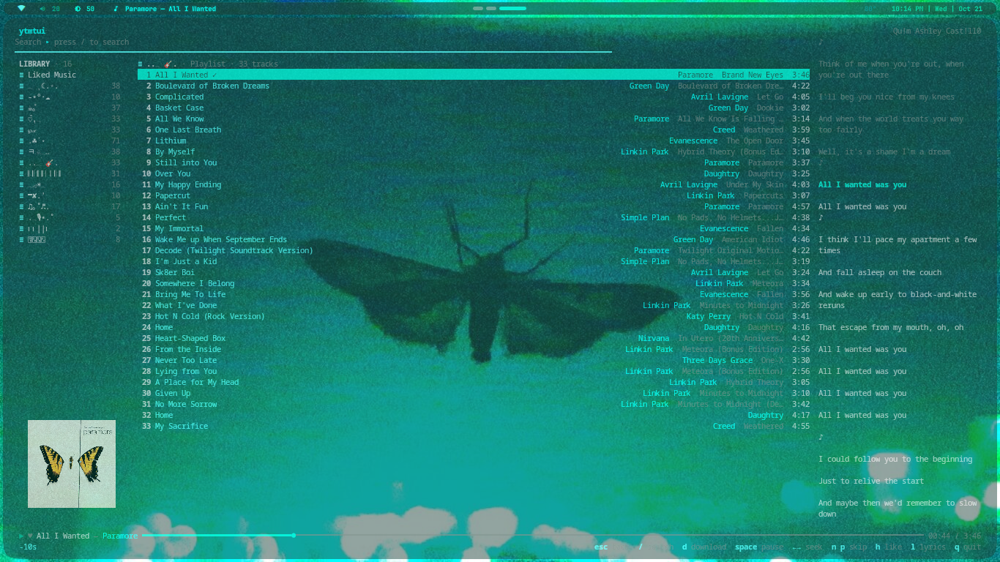
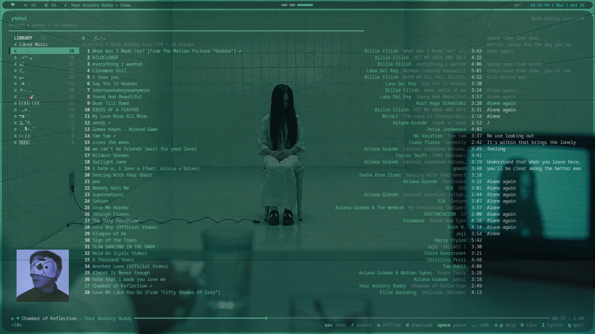
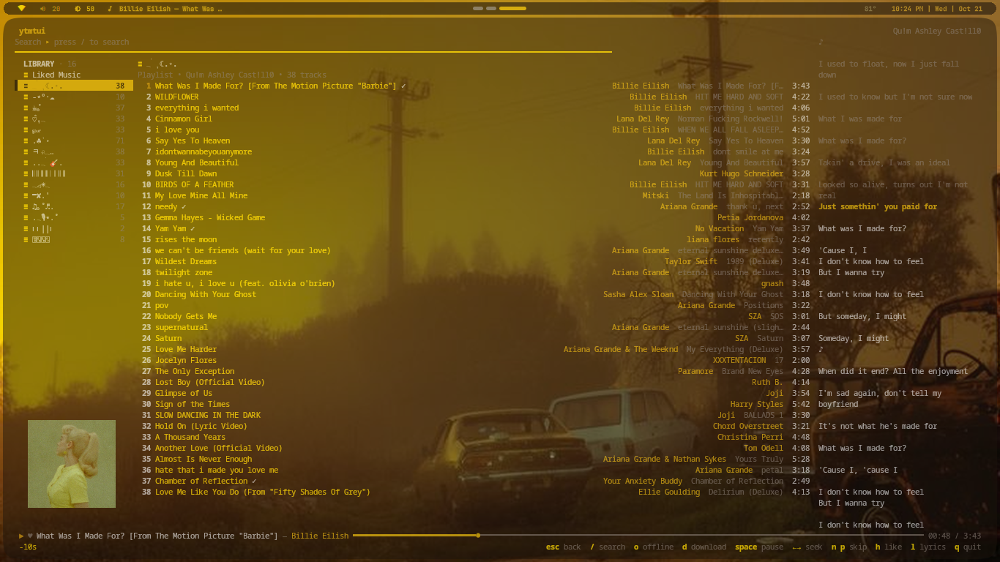
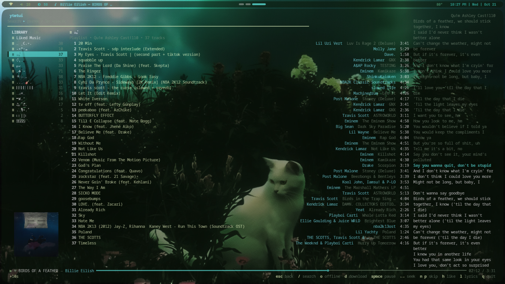

<div align="center">

# ♪ ytmtui ♫

**A minimal, lightning-fast YouTube Music TUI written in Rust**  
featuring an **mpv** backend · download songs · synced lyrics · offline mode · straight forward keybindings

<br>

[](https://www.rust-lang.org/)
[](https://mpv.io/)
[](LICENSE)
[](https://aur.archlinux.org/packages/ytmtui)
[](https://github.com/Bell09/ytmtui)

<br>

[](#-install)
[](#-quick-start)
[](#%EF%B8%8F-keybindings)
[](#-theming)
[](#-license)

<br>



</div>

---

## ✨ Features

| | |
| :--- | :--- |
| 🖥️ **Terminal UI** | Built with `ratatui` + `crossterm` — chrome-free, hairlines & whitespace only |
| 🔐 **Auth wizard** | `ytmtui setup` auto-detects your browser and extracts cookies |
| 🔍 **Innertube search** | Signed-in search with Top / Songs / Albums / Artists / Playlists filters |
| 📚 **Your library** | Master–detail browser of playlists, artists & channels with lazy track preview |
| ▶️ **Playback** | Real-time progress bar, true pause/resume via `mpv` IPC, buffering state |
| 💫 **Extras** | Synced lyrics, queue, offline mode, like/unlike, MP3 download with cover art and `.lrc` lyrics |

---

## 📸 Screenshots

<div align="center">

| | |
| :---: | :---: |
|  |  |



</div>

---

## 📦 Install

### Arch Linux (AUR)

```bash
paru -S ytmtui
# or
yay -S ytmtui
```

### From source

```bash
git clone https://github.com/Bell09/ytmtui.git
cd ytmtui
cargo build --release
# binary lands in target/release/ytmtui
```

---

## 📋 Dependencies

### Runtime (required)

| Dependency | Purpose |
| :--- | :--- |
| **mpv** | Playback backend (controlled via IPC) |
| **Rust** ≥ 1.75 | Only needed when building from source |

Install on Arch:

```bash
sudo pacman -S mpv
```

### Optional (recommended)

| Dependency | Purpose |
| :--- | :--- |
| **yt-dlp** | Better stream extraction / fallback |
| **ffmpeg** | Used when downloading songs as MP3 |

```bash
sudo pacman -S yt-dlp ffmpeg
```

### Rust crates (main)

| Crate | Purpose |
| :--- | :--- |
| `ratatui` + `crossterm` | Terminal UI |
| `tokio` | Async runtime |
| `reqwest` | HTTP / Innertube API |
| `serde` / `serde_json` | Serialization |
| `rusqlite` | Local offline database |
| `lofty` | Audio metadata & cover art |
| `zbus` | MPRIS support |
| `image` | Cover art processing |

---

## 🚀 Quick start

```bash
ytmtui setup              # interactive auth wizard (auto-detects browser)
ytmtui                    # launch the TUI
```

<details>
<summary><strong>⚙️ Setup options</strong></summary>

```bash
ytmtui setup --manual          # skip browser detection, paste headers
ytmtui setup --browser firefox # force a specific browser
```

</details>

---

## 🔑 Setup & Authentication

The wizard walks you through signing in:

1. Shows the **YouTube Music Authentication** banner
2. If already authenticated, asks whether to re-authenticate
3. Auto-detects a signed-in browser and extracts cookies (falls back to manual paste)
4. Identifies the account and lets you pick between multiple Google accounts
5. Verifies credentials against YouTube Music

Credentials live in `~/.config/ytmtui/auth.json`.

### 🌐 Browser auto-extraction

Supported browsers (checked in order):

`helium` · `chrome` · `chromium` · `brave` · `firefox` · `zen` · `edge` · `vivaldi` · `opera`

| Family | Method |
| :--- | :--- |
| 🦊 **Firefox / Zen** | Reads `cookies.sqlite` directly |
| 🧭 **Chromium family** | Decrypts the Cookies DB with AES-128-CBC using the login keyring (`secret-tool`) or Chrome’s Linux fallback |

Databases are copied privately, so a running browser never blocks extraction. Flatpak / snap paths are handled too.

### 📋 Manual header paste

```bash
ytmtui setup --manual
```

1. Open [music.youtube.com](https://music.youtube.com) → **F12** → **Network** → refresh
2. Click any `/browse` request → right-click **Request Headers** → **Copy**
3. Paste into the wizard, then press **Enter** on a blank line

Only have the `cookie` value? Paste that — the wizard fills in the rest.

---

## ⌨️ Keybindings

| Key | Action |
| :--- | :--- |
| `↑` / `↓` or `j` / `k` | Navigate lists |
| `Enter` | Play / open selection |
| `Space` | Play / Pause |
| `←` / `→` | Seek -5s / +5s |
| `n` / `p` | Next / previous track |
| `/` | Focus search bar |
| `Tab` / `⇧Tab` | Cycle search filters |
| `Esc` | Back / open queue |
| `d` | Download highlighted song as MP3 with cover art and synced `.lrc` (or delete in queue) |
| `o` | Toggle offline mode |
| `h` | Like / unlike current song |
| `l` | Toggle lyrics pane |
| `X` / `Z` | Queue next / append to queue |
| `Ctrl+R` | Cycle repeat mode |
| `Ctrl+S` | Toggle shuffle |
| `PgUp` / `PgDn` | Scroll lyrics or detail pane |
| `q` | Quit |

---

## 🖼️ Views

The window is deliberately chrome-free — no box borders, just hairlines, whitespace and right-aligned metadata. Colour comes from your **wallpaper** palette.

- 📌 **Header** — app name, signed-in account, search prompt  
  Press `/` to search · `Tab` / `⇧Tab` switches **Top · Songs · Albums · Artists · Playlists**
- 📂 **Playlist sidebar** — always-visible library of playlists, albums, artists & channels  
  `↑`/`↓` moves the `▌` cursor · `Enter` opens the selection
- 📄 **Detail / results** — title, meta line and lazily-fetched track list (cached)
- 🎚️ **Playback bar** — indicator, track, time and a full-width progress bar that only advances while playing
- ℹ️ **Footer** — status message + compact keybinding cheat-sheet

---

## 🎨 Theming

Colors are detected from the newest palette written by **pywal**, **wallust** or **matugen**:

- **pywal** — `$XDG_CACHE_HOME/wal/colors.json` (or the `colors` file)
- **wallust** — `$XDG_CACHE_HOME/wallust/colors.json` (or `wallust/colors`), plus JSON `target`/`dst` outputs declared in `~/.config/wallust/wallust.toml`
- **matugen** — `colors.json` in its cache/config/data directories, plus JSON `output_path` outputs declared in `~/.config/matugen/config.toml`

Matugen's Material role JSON (flat or nested) and base16 JSON are supported. The accent colour marks everything active — the `▌` cursors, progress bar, playing indicator and current search filter. Secondary text (meta, counts, hairlines, status) is dimmed. The palette is watched live, so a wallpaper change repaints without a restart; no palette found → a built-in fallback is used.

---

## 🛠️ CLI helpers

```bash
ytmtui status            # show the signed-in account
ytmtui playlists         # list library playlists, artists and channels
ytmtui liked             # list liked songs
ytmtui tracks <id>       # list tracks of a playlist / album / artist
                         # (VLPL…, VLLM…, MPREb…)
```

---

## 📄 License

MIT © [Bell09](https://github.com/Bell09)
