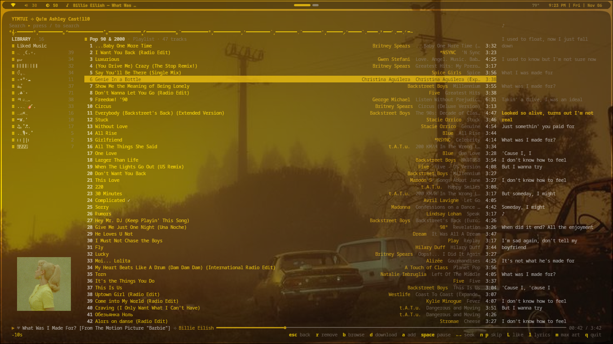
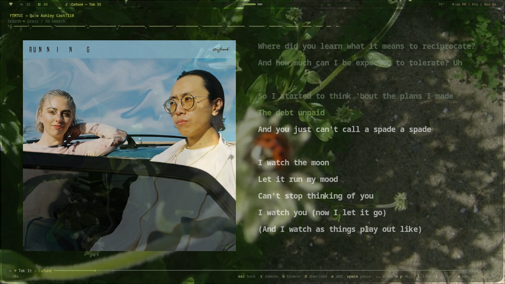

<div align="center">

# ♪ YTMTUI ♫

**A minimal, lightning-fast YouTube Music TUI written in Rust**  
featuring an **mpv** backend · download songs with Embedded album art + lyrics · synced lyrics · offline mode · straight forward keybindings

<br>

[](https://www.rust-lang.org/)
[](https://mpv.io/)
[](LICENSE)
[](https://aur.archlinux.org/packages/ytmtui)
[](https://github.com/Bell09/ytmtui)

<br>

[](#-install)
[](#-quick-start)
[](#%EF%B8%8F-keybindings)
[](#-theming)
[](#-license)

<br>


</div>

> **Solo project** — Built and maintained by me.  
> Pull requests are not accepted. Issues for bugs are welcome.  

---

## ✨ Features

| | |
| :--- | :--- |
| 🖥️ **Terminal UI** | Built with `ratatui` + `crossterm` — chrome-free, hairlines & whitespace only |
| 🔐 **Auth wizard** | `ytmtui setup` auto-detects your browser and extracts cookies |
| 🔍 **Innertube search** | Signed-in search with Top / Songs / Albums / Artists / Playlists filters |
| 📚 **Your library** | Master–detail browser of playlists, artists & channels with lazy track preview |
| ✨ **For you** | Personal mixes, subscriptions, trending songs, community playlists, activity mixes, moods, genres, and country/global charts |
| ▶️ **Playback** | Real-time progress bar, true pause/resume via `mpv` IPC, next-track prefetch, automatic retry/skip on stream failures · `m` for a maximized cover + synced lyrics view |
| 💫 **Extras** | Synced lyrics, queue, offline mode, like/unlike, MP3 download with cover art and `.lrc` lyrics |

---

## 📸 Screenshots

<div align="center">







</div>

---

## 📦 Install

### One-line install

```bash
curl -fsSL https://raw.githubusercontent.com/Bell09/ytmtui/main/install.sh | sh
```

| Option | Result |
|--------|--------|
| Default | Installs to `~/.local/bin` |
| `sh install.sh --system` | Installs to `/usr/local/bin` |
| `YTMTUI_VERSION=0.1.15` | Pins a specific version |

The script verifies the download checksum before installing.

### Release binaries

Download `ytmtui-x86_64-linux.tar.gz` from the [latest release](https://github.com/Bell09/ytmtui/releases/latest) and place the binary on your `PATH`.

### Arch Linux

Add the custom repository to `/etc/pacman.conf`:

```ini
[ytmtui]
SigLevel = Optional TrustAll
Server = https://bell09.github.io/ytmtui/$arch
```

Then install:

```bash
sudo pacman -Sy ytmtui
```

> Packages are currently unsigned (`TrustAll`). Future updates are picked up with `pacman -Syu`.

### From source

```bash
git clone https://github.com/Bell09/ytmtui.git
cd ytmtui
cargo build --release
```

Binary lands in `target/release/ytmtui`.

---

## 📋 Dependencies

### Runtime (required)

| Dependency | Purpose |
| :--- | :--- |
| **mpv** | Playback backend (controlled via IPC) |
| **Rust** ≥ 1.89 | Only needed when building from source |

Install on Arch:

```bash
sudo pacman -S mpv
```

### Optional (recommended)

| Dependency | Purpose |
| :--- | :--- |
| **yt-dlp** | Better stream extraction / fallback |
| **ffmpeg** | Used when downloading songs as MP3 |

```bash
sudo pacman -S yt-dlp ffmpeg
```

### Rust crates (main)

| Crate | Purpose |
| :--- | :--- |
| `ratatui` + `crossterm` | Terminal UI |
| `tokio` | Async runtime |
| `reqwest` | HTTP / Innertube API |
| `serde` / `serde_json` | Serialization |
| `rusqlite` | Local offline database |
| `lofty` | Audio metadata & cover art |
| `zbus` | MPRIS support |
| `image` | Cover art processing |

---

## >_ Supported Terminals

Album art is rendered as **true high-resolution images** on terminals that support the **Kitty graphics protocol**. All other terminals fall back to Unicode quadrant blocks.

| Terminal     | True images | 2× text scaling (lyrics) |
|--------------|-------------|---------------------------|
| **Kitty**    | ✅          | ✅ (≥ 0.40)              |
| **WezTerm**  | ✅          | ✅                        |
| **Ghostty**  | ✅          | ✅                        |
| **Konsole**  | ✅          | ❌                        |

**Kitty ≥ 0.40** is recommended for the full experience (images + 2× lyrics text in the maximized view).

---

## 🚀 Quick start

```bash
ytmtui setup              # interactive auth wizard (auto-detects browser)
ytmtui                    # launch the TUI
```

<details>
<summary><strong>⚙️ Setup options</strong></summary>

```bash
ytmtui setup --manual          # skip browser detection, paste headers
ytmtui setup --browser firefox # force a specific browser
```

</details>

---

## 🔑 Setup & Authentication

The wizard walks you through signing in:

1. Shows the **YouTube Music Authentication** banner
2. If already authenticated, asks whether to re-authenticate
3. Auto-detects a signed-in browser and extracts cookies (falls back to manual paste)
4. Identifies the account and lets you pick between multiple Google accounts
5. Verifies credentials against YouTube Music

Credentials live in `~/.config/ytmtui/auth.json`.

### 🌐 Browser auto-extraction

Supported browsers (checked in order):

`helium` · `chrome` · `chromium` · `brave` · `firefox` · `zen` · `edge` · `vivaldi` · `opera`

| Family | Method |
| :--- | :--- |
| 🐺 **Firefox / Zen** | Reads `cookies.sqlite` directly |
| 🧭 **Chromium family** | Decrypts the Cookies DB with AES-128-CBC using the login keyring (`secret-tool`) or Chrome’s Linux fallback |

Databases are copied privately, so a running browser never blocks extraction. Flatpak / snap paths are handled too.

### 📋 Manual header paste

```bash
ytmtui setup --manual
```

1. Open [music.youtube.com](https://music.youtube.com) → **F12** → **Network** → refresh
2. Click any `/browse` request → right-click **Request Headers** → **Copy**
3. Paste into the wizard, then press **Enter** on a blank line

Only have the `cookie` value? Paste that — the wizard fills in the rest.

---

## ⌨️ Keybindings

| Key | Action |
| :--- | :--- |
| `↑` / `↓` | Navigate lists |
| `Enter` | Play / open selection |
| `Space` | Play / Pause |
| `←` / `→` | Seek -5s / +5s |
| `n` / `p` | Next / previous track |
| `1`–`5` | Jump to **Trending / Mix / Community / Moods / Genres** |
| `/` | Focus search bar |
| `Tab` / `⇧Tab` | Cycle search filters |
| `Esc` | Back / leave the maximized view |
| `d` | Download highlighted song as MP3 with cover art and synced `.lrc` (or delete in queue) |
| `a` | Add highlighted song to a library playlist — arrows scroll, `Enter` adds |
| `c` | Create a new private playlist — type a name, `Enter` creates it |
| `r` | Remove highlighted song from the open playlist (rolls back on failure) |
| `o` | Toggle offline mode and online mode |
| `L` | Like / unlike current song — in Liked Music it targets the highlighted row |
| `l` | Toggle lyrics pane |
| `m` | Toggle maximized now playing view (large cover + full-height lyrics) |
| `X` / `Z` | Queue next / append to queue |
| `Ctrl+R` | Cycle repeat mode |
| `Ctrl+S` | Toggle shuffle |
| `PgUp` / `PgDn` | Scroll lyrics or detail pane |
| `q` | Quit |

---

## 🖼️ Views

The window is deliberately chrome-free — no box borders, just hairlines, whitespace and right-aligned metadata. Colour comes from your **wallpaper** palette.

| Area | Description |
|------|-------------|
| 📌 **Header** | App name, signed-in account and search prompt. Press `/` to search · `Tab` / `⇧Tab` cycles **Top · Songs · Albums · Artists · Playlists** |
| 📂 **Playlist sidebar** | Always-visible library of playlists, albums, artists & channels. `↑`/`↓` moves the `▌` cursor · `Enter` opens the selection |
| 📄 **Detail / results** | Title, meta line and lazily-fetched track list (cached) |
| ✨ **For you** | Press `b` for the shelf picker. `1`–`5` jump straight to the first five shelves |
| 🎚️ **Playback bar** | Indicator, track, time and a full-width progress bar that only advances while playing |
| 🖼️ **Now playing** | Press `m` for a large centred cover beside full-height synced lyrics (2× text in Kitty ≥ 0.40). `PgUp` / `PgDn` scrolls · `m` or `Esc` returns |
| ℹ️ **Footer** | Status message and compact keybinding cheat-sheet |

**For you shelves** (accessible via `b` or hotkeys `1`–`5`):

Quick picks · Your daily discover · Featured playlists for you · My subscriptions · Forgotten favorites · From the community · Moods & genres · Activity mixes · Discovery mix · Mixed for you · New releases · Covers and remixes · Trending community playlists · Trending songs · Country charts · Global charts

---

## 🎨 Theming

YTMTUI automatically picks up the newest color palette written by your wallpaper tools.

| Tool        | Paths searched |
|-------------|----------------|
| **pywal**   | `$XDG_CACHE_HOME/wal/colors.json` <br> or the plain `colors` file |
| **wallust** | `$XDG_CACHE_HOME/wallust/colors.json` (or `wallust/colors`) <br> + any JSON `target` / `dst` declared in `~/.config/wallust/wallust.toml` |
| **matugen** | `colors.json` in its cache / config / data directories <br> + any JSON `output_path` declared in `~/.config/matugen/config.toml` |

Matugen’s Material role JSON (flat or nested) and base16 JSON are both supported.

**How colors are used**

| Role        | Applied to |
|-------------|------------|
| **Accent**  | Active elements — `▌,'.~‎♪♬.༺❜´˚` cursors, progress bar, playing indicator, text, current search filter |
| **Secondary** | Meta text, counts, hairlines, status messages (dimmed) |

The palette is watched live — change your wallpaper and the UI repaints without a restart.  
If no palette is found, a built-in **green** fallback is used.

---

## 🛠️ CLI helpers

```bash
ytmtui status            # show the signed-in account
ytmtui playlists         # list library playlists, artists and channels
ytmtui liked             # list liked songs
ytmtui tracks <id>       # list tracks of a playlist / album / artist
                         # (VLPL…, VLLM…, MPREb…)
```

---

## 📄 License

MIT © [Bell09](https://github.com/Bell09)
